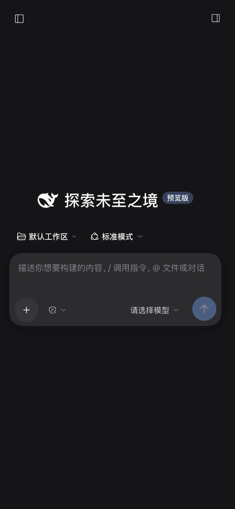
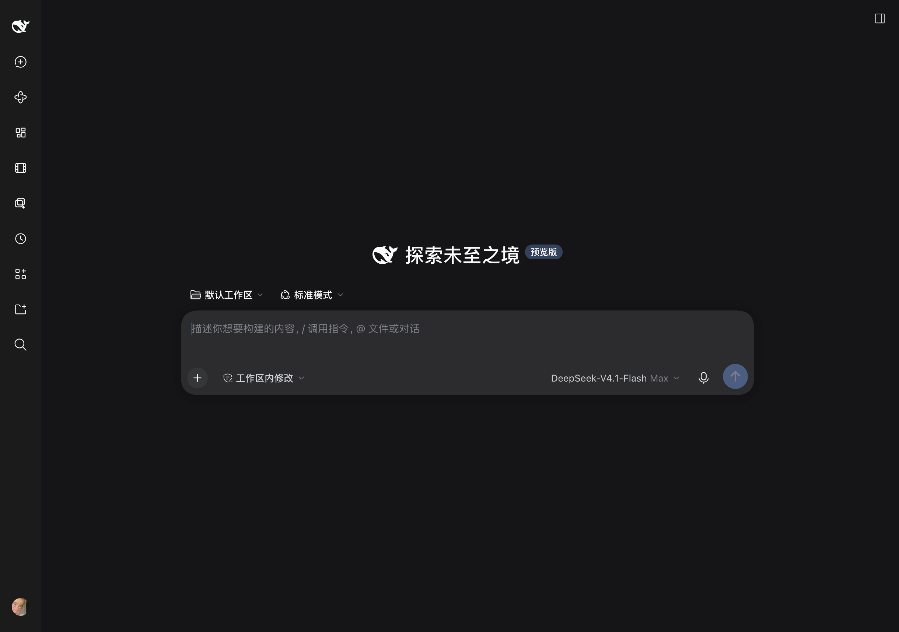

# dsh-mobile-remote

[English](README.md) | [简体中文](README.zh-CN.md)

[](https://github.com/monsterjakey/dsh-mobile-remote/releases)
[](LICENSE)


Use the **same live [DeepSeek Harness](https://github.com/deepseek-ai/deepseek-harness) (DSH) session from your iPhone or iPad** — with a proper mobile skin, one-time pairing, and zero public exposure.

A tiny **[DSH](https://github.com/deepseek-ai/deepseek-harness) plugin**: no second DSH, no data sync, no rewrite of the official Web UI. Your phone is simply another window into the DSH running on your Mac, over [Tailscale](https://tailscale.com).

<p align="center"></p>

## Why it's nice

- **Ridiculously simple.** Install with one `dsh plugin add` command, pair with a 6-digit code. No frontend rebuild, no reverse-proxy config, no public IP, no extra server.
- **Tiny and dependency-free.** ~19 KB install package; three small JS files and one CSS file; **zero runtime npm dependencies**, no telemetry, no third-party requests.
- **Secure by default.** DSH keeps listening on `127.0.0.1`; the plugin never touches Funnel; authentication stays the official launch-token → signed-cookie flow. The pairing code is single-use with a 30-minute TTL, and the token never leaves the Mac.
- **Self-healing.** The desktop Host gets a new random port on every launch. The plugin automatically re-points `tailscale serve` at it, retries at 2/5/10/20/40 s after boot, then reconciles every 5 minutes. Sleep, crash, restart — the phone still works.
- **Native, not a skin wrapper app.** It's the real official Web UI and the real session: same files, same running jobs, same conversation.
- **Auditable.** MIT, ~800 lines total, a built-in exposure checker (`scripts/check-exposure.mjs`) that verifies Funnel is off, Serve is tailnet-only, and Tailscale SSH is off.

## Even better on iPhone Duo (landscape)

Unfolded in landscape, iPhone Duo gives the plugin a small-tablet canvas: the
sidebar and the conversation can sit side by side, code blocks and tables need
far less horizontal scrolling, and long sessions are much more comfortable to
read. Above 1024 px the plugin deliberately keeps the official desktop layout
and only adds the touch scroll rescue + floating ↑/↓ page buttons.

<p align="center"></p>

> Screenshot: 1220 × 858 CSS viewport (iPhone Duo unfolded, landscape), sidebar collapsed for focus.

## Pair from the left sidebar

After installing and restarting DSH Desktop, a **Mobile remote** entry appears in
the left sidebar. It shows the live pairing code with a countdown, and offers:

- **Copy code** — paste it into the phone pairing page;
- **New code** — rotate the pairing code immediately;
- **Copy pairing page** / **Open pairing page** — jump straight to
  `/__dshm/pair` on the tailnet URL;
- **Copy command** — the terminal fallback.

The code shown here is injected into the authenticated page by the Host; the
launch token never enters the page. On a phone (tailnet page) the same panel
still opens, but code reading/refreshing is a Mac-side action.

## How it works

```
iPhone / iPad Safari
  │  https://<this-mac>.<tailnet>.ts.net   (Tailscale: WireGuard + HTTPS, tailnet only)
  ▼
tailscaled on the Mac (tailscale serve --https=443 → 127.0.0.1:<DSH port>)
  ▼
The same DSH Host the desktop app is running
  ├─ official Web UI (index / assets / API / WebSocket)
  └─ dsh-mobile-remote plugin:
       · injects viewport/safe-area meta + /__dshm/mobile.css|js
       · serves /__dshm/pair (6-digit code, 30 min, single use)
       · writes ~/.dsh/mobile-remote.json (0600: token URL + pairing code)
       · reconciles `tailscale serve` after every boot and every 5 minutes
```

The phone never receives a copy of your data and never talks to a third-party relay: Tailscale creates a private WireGuard tunnel straight to your Mac.

## Features

- Phone/tablet skin scoped to `html.dshm-mobile` — desktop UI unaffected; large tablet layouts keep the official layout.
- **Left sidebar page**: after restart, open **Mobile remote** to see the current pairing code, copy it, rotate it with one click, or open the pairing page — no terminal needed.
- `#dshm-off` / `#dshm-on` switch for A/B testing (persisted in localStorage).
- Pairing page with short code; the launch token stays on the Mac.
- `scripts/pairing.mjs`: print (`--refresh` to rotate) the current pairing code from the command line.
- Automatic tailnet URL detection (`tailscale status --json`) and serve refresh.
- Touch scroll rescue for iOS Safari + floating ↑/↓ page buttons.
- `scripts/check-exposure.mjs`: verifies Funnel is off, Serve is tailnet-only,
  Tailscale SSH is off, and the Serve target matches the current DSH port.
- `scripts/setup-profile.mjs`: computes your tailnet hostname, backs up the
  profile patch, and writes the required deployment entries.

## Requirements

- DeepSeek Harness Desktop `0.2.2.x` (`dsh.compatibility.dsh = ">=0.2.2-0 <0.3.0"`).
- The Mac and the phone logged into the **same tailnet**.
- Tailscale **HTTPS certificates** enabled for the tailnet (admin console → DNS),
  and the `tailscale` CLI available (`/usr/local/bin/tailscale` by default).
- Tailscale app on the phone.

## Install

### From GitHub (recommended)

```bash
DSH="/Applications/DeepSeek Harness.app/Contents/Resources/runtime/cli/bin/dsh"
"$DSH" plugin --profile desktop add -w github:monsterjakey/dsh-mobile-remote
node ~/.dsh/profiles/desktop/node_modules/dsh-mobile-remote/scripts/setup-profile.mjs
```

### From a clone

```bash
git clone https://github.com/monsterjakey/dsh-mobile-remote.git
cd dsh-mobile-remote
DSH="/Applications/DeepSeek Harness.app/Contents/Resources/runtime/cli/bin/dsh"
"$DSH" plugin --profile desktop add -w "link:$PWD"
node ~/.dsh/profiles/desktop/node_modules/dsh-mobile-remote/scripts/setup-profile.mjs
```

### From the release tarball

```bash
"$DSH" plugin --profile desktop add -w file:/path/to/dsh-mobile-remote-0.3.1.tgz
```

Then restart DSH Desktop once, and on the phone:

1. Open `https://<this-mac>.<tailnet>.ts.net/__dshm/pair`
2. Enter the `pairingCode` from `~/.dsh/mobile-remote.json`
3. Bookmark `https://<this-mac>.<tailnet>.ts.net/` (cookie lasts 7 days)

## Troubleshooting

iPhone/iPad cannot reach DSH:

```bash
node ~/.dsh/profiles/desktop/node_modules/dsh-mobile-remote/scripts/check-exposure.mjs
```

- If it reports `serve target port X != DSH port Y`:
  `tailscale serve --bg --https=443 <Y>` (the plugin also retries automatically).
- Make sure Tailscale on the phone is connected and **Use Tailscale DNS** is on
  (otherwise `*.ts.net` names do not resolve).
- Keep the Mac awake (`caffeinate`) for long sessions.

Layout/scroll issues: append `#dshm-off` to the URL to disable the mobile skin
and compare with the official layout; `#dshm-on` restores it.

## Pairing code expired?

The pairing code is a **30-minute single-use** code by design. Already-paired
phones keep working through the 7-day login cookie — you only need a code after
clearing Safari data, changing phones, or revoking the cookie.

1. **Start the Tailscale app first.** If Tailscale is stopped, the phone cannot
   reach the Mac at all, regardless of the pairing code.
2. Print the current code, or rotate it immediately:

   ```bash
   node ~/.dsh/profiles/desktop/node_modules/dsh-mobile-remote/scripts/pairing.mjs
   node ~/.dsh/profiles/desktop/node_modules/dsh-mobile-remote/scripts/pairing.mjs --refresh
   ```

3. Open `https://<this-mac>.<tailnet>.ts.net/__dshm/pair` and enter the code.

On 0.2.3+ the plugin rotates expired/used codes automatically when the pairing
page is opened, and republishes `~/.dsh/mobile-remote.json`. The running plugin
must be 0.2.3 or newer — restart DSH Desktop once after upgrading.

## Uninstall

```bash
DSH="/Applications/DeepSeek Harness.app/Contents/Resources/runtime/cli/bin/dsh"
"$DSH" plugin --profile desktop remove -w dsh-mobile-remote
# remove the "dsh-mobile-remote setup" block from
# ~/.dsh/profiles/desktop/cordis.patch.yml
rm -f ~/.dsh/mobile-remote.json
tailscale serve reset   # only if you have no other serve configuration
```

## Security

This plugin gives a paired phone **owner-level** access to the DSH on your Mac:
the agent can run shell commands and read/write files. Keep the phone locked,
keep Funnel disabled, and restrict the tailnet with an ACL that only allows your
phone to reach this Mac on `tcp:443`. See [SECURITY.md](SECURITY.md) and
[INSTALL.md](INSTALL.md).

## License

MIT. See [LICENSE](LICENSE). DeepSeek and DeepSeek Harness are trademarks of
their respective owners; this is an independent community project.
