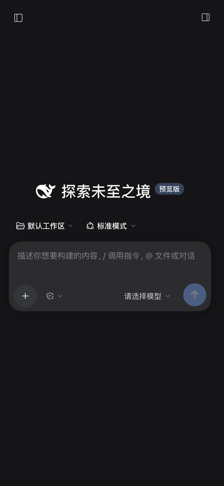
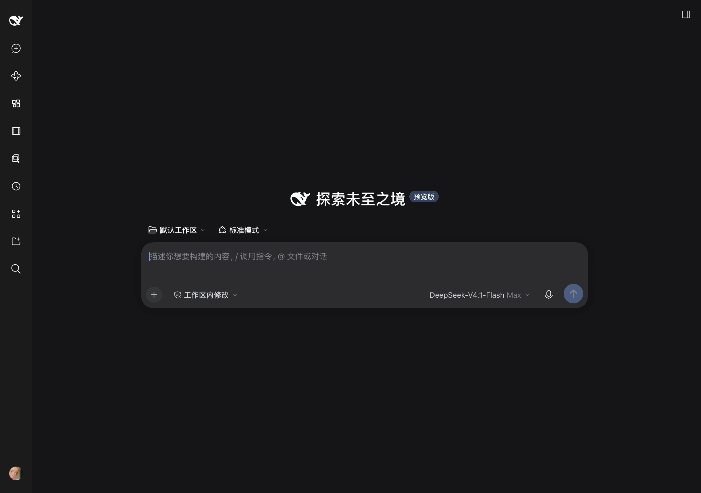

# dsh-mobile-remote

[English](README.md) | [简体中文](README.zh-CN.md)

[](https://github.com/monsterjakey/dsh-mobile-remote/releases)
[](LICENSE)


**在 iPhone / iPad 上，继续用电脑上正在跑的那个 DSH 会话。**

一个很小的 **[DeepSeek Harness](https://github.com/deepseek-ai/deepseek-harness)（DSH）插件**：不用双开、不用同步、不改官方 Web UI。手机只是透过 [Tailscale](https://tailscale.com) 看进你在 Mac 上的那一个 DSH。

<p align="center"></p>

## 为什么它值得用？

- **装起来只要一条命令**：`dsh plugin add` + 6 位配对码，完事。不用改前端、不用编译、不用公网 IP、不用额外服务器、不用 Nginx、不用证书手动折腾。
- **小到离谱**：安装包约 **19 KB**，核心就是 3 个 JS + 1 个 CSS，**零 npm 运行时依赖**，没有遥测，没有第三方请求。
- **默认安全**：DSH 始终只监听 `127.0.0.1`；插件从不碰 Funnel（公网入口）；登录继续用官方的 launch token → 签名 cookie；配对码 30 分钟一次性有效，token 永不离开 Mac；还自带安全检查脚本。
- **会自己修**：DSH 每次启动端口都是随机的，插件会自动把 `tailscale serve` 指回当前端口（开机后 2/5/10/20/40 秒重试，之后每 5 分钟巡检）。Mac 睡眠、DSH 重启、崩溃恢复，手机第二天照样能连。
- **原生体验，不是套壳 App**：看到的就是官方 Web UI 和真实会话——同一个项目、同一个正在跑的任务、同一份上下文。手机只是换了一块屏幕。
- **代码短、可审计**：MIT，大约 800 行；没有遥测；`scripts/check-exposure.mjs` 一键检查 Funnel 是否关闭、Serve 是否仅 tailnet、Tailscale SSH 是否关闭、端口是否对得上。

## iPhone Duo 横屏体验更佳

展开横屏后，iPhone Duo 接近一块小尺寸平板：侧栏和对话可以并排，代码块/表格需要横向滚动的次数明显变少，长会话读起来也舒服得多。宽度超过 1024px 时插件会自动保留官方桌面布局，只额外提供触摸滚动救援和右下角 ↑/↓ 翻页按钮。

<p align="center"></p>

> 截图：1220 × 858 CSS 视口（iPhone Duo 展开横屏，侧栏收起专注对话）。

## 直接在左侧「手机远程」页面配对

安装并重启一次 DSH Desktop 后，左侧会多出 **手机远程** 入口。页面会显示
当前配对码和倒计时，并提供：

- **复制配对码** —— 直接粘到手机配对页；
- **换一个** —— 立刻轮换新的配对码；
- **复制配对页 / 打开配对页** —— 直接打开 tailnet 上的 `/__dshm/pair`；
- **复制命令** —— 终端兜底方案。

页面里的配对码由 Host 注入到已登录页面，token 不会进入网页。在手机上打开
同一个页面也能看说明，但读码/换码仍建议在 Mac 端操作。

## 它是怎么工作的

```
iPhone / iPad 上的 Safari
  │  https://<你的机器>.<你的 tailnet>.ts.net   （Tailscale：WireGuard + HTTPS，仅 tailnet 内可达）
  ▼
Mac 上的 tailscaled（tailscale serve --https=443 → 127.0.0.1:<DSH 端口>）
  ▼
桌面版 DSH 正在跑的那个 Host（同一个）
  ├─ 官方 Web UI（页面 / 静态资源 / API / WebSocket）
  └─ dsh-mobile-remote 插件：
       · 注入手机 viewport / 安全区 meta + /__dshm/mobile.css|js
       · 提供 /__dshm/pair（6 位配对码、30 分钟、一次性）
       · 写 ~/.dsh/mobile-remote.json（0600：带 token 的链接 + 配对码）
       · 每次开机重试并每 5 分钟校正 `tailscale serve` 目标
```

手机拿不到你的数据副本，也不经过第三方中转：Tailscale 建一条从手机直达你 Mac 的 WireGuard 私有隧道。

## 功能

- 手机/平板皮肤，作用域只有 `html.dshm-mobile` —— 桌面端完全不受影响，大屏平板保留官方布局；
- **左侧新增「手机远程」页面**：安装并重启一次后，点开就能看到当前配对码，可复制、一键换新、打开配对页，不用再开终端。
- `#dshm-off` / `#dshm-on` 一键开关皮肤（localStorage 记住选择），方便对比和排障；
- 6 位码配对页；token 只在 Mac 本地交换，不显示在 UI 里；
- `scripts/pairing.mjs`：命令行查看（`--refresh` 立即换新）当前配对码。
- 自动探测 tailnet 域名（`tailscale status --json`）并刷新 `tailscale serve`；
- iOS Safari 触摸滚动救援 + 右下角 ↑/↓ 翻页按钮；
- `scripts/check-exposure.mjs`：检查 Funnel 关闭、Serve 仅 tailnet、Tailscale SSH 关闭、Serve 目标端口与当前 DSH 端口一致；
- `scripts/setup-profile.mjs`：自动算出你的 tailnet 域名、备份 profile patch、写入部署所需配置。

## 环境要求

- DeepSeek Harness Desktop `0.2.2.x`（`dsh.compatibility.dsh = ">=0.2.2-0 <0.3.0"`）；
- Mac 和手机登录**同一个 tailnet**；
- 在 Tailscale 管理台为 tailnet 开启 **HTTPS 证书**（Admin console → DNS）；
- Mac 上有 `tailscale` CLI（默认 `/usr/local/bin/tailscale`）；
- 手机安装 Tailscale App。

## 安装

### 从 GitHub 安装（推荐）

```bash
DSH="/Applications/DeepSeek Harness.app/Contents/Resources/runtime/cli/bin/dsh"
"$DSH" plugin --profile desktop add -w github:monsterjakey/dsh-mobile-remote
node ~/.dsh/profiles/desktop/node_modules/dsh-mobile-remote/scripts/setup-profile.mjs
```

### 从源码安装

```bash
git clone https://github.com/monsterjakey/dsh-mobile-remote.git
cd dsh-mobile-remote
DSH="/Applications/DeepSeek Harness.app/Contents/Resources/runtime/cli/bin/dsh"
"$DSH" plugin --profile desktop add -w "link:$PWD"
node ~/.dsh/profiles/desktop/node_modules/dsh-mobile-remote/scripts/setup-profile.mjs
```

### 从 Release 安装包安装

```bash
"$DSH" plugin --profile desktop add -w file:/path/to/dsh-mobile-remote-0.3.0.tgz
```

然后重启一次 DSH Desktop，在手机上：

1. 打开 `https://<你的机器>.<你的 tailnet>.ts.net/__dshm/pair`
2. 输入 `~/.dsh/mobile-remote.json` 里的 `pairingCode`
3. 之后收藏 `https://<你的机器>.<你的 tailnet>.ts.net/`（cookie 7 天有效）

## 安全检查

```bash
node ~/.dsh/profiles/desktop/node_modules/dsh-mobile-remote/scripts/check-exposure.mjs
```

正常应看到：**Funnel 关闭、Serve 仅 tailnet、Tailscale SSH 关闭、serve 端口与 DSH 端口一致**。
如果提示端口不一致，脚本会直接给出修复命令；插件本身也会自动重试修复。

## 排障

**手机连不上：**

```bash
node ~/.dsh/profiles/desktop/node_modules/dsh-mobile-remote/scripts/check-exposure.mjs
```

- 提示 `serve target port X != DSH port Y`：执行 `tailscale serve --bg --https=443 <Y>`（插件也会自动修）；
- 确认手机 Tailscale 已连接，并开启 **Use Tailscale DNS**（关掉后 `*.ts.net` 域名无法解析）；
- 长时间会话建议 `caffeinate` 保持 Mac 不睡眠。

**布局 / 滚动问题：** 在网址后加 `#dshm-off` 可停用移动皮肤、对比官方布局；`#dshm-on` 恢复。

## 配对码过期了怎么办？

配对码是**30 分钟有效、一次性**的，这是安全设计。已经配对过的手机靠 **7 天登录 cookie** 继续使用，只有在清理了 Safari 数据、换手机或撤销 cookie 之后才需要重新输码。

1. **先确认 Tailscale 在运行**。Tailscale 停止时手机根本连不上 Mac，和配对码无关。
2. 读出当前配对码，或立即换一个新码：

   ```bash
   node ~/.dsh/profiles/desktop/node_modules/dsh-mobile-remote/scripts/pairing.mjs
   node ~/.dsh/profiles/desktop/node_modules/dsh-mobile-remote/scripts/pairing.mjs --refresh
   ```

3. 手机打开 `https://<你的机器>.<你的 tailnet>.ts.net/__dshm/pair`，输入新码即可。

0.2.3 起，插件在配对页被打开时会自动轮换过期/已使用的码，并同步写入
`~/.dsh/mobile-remote.json`，不再需要重启 DSH。当前运行的插件需要是
0.2.3 或更新；升级后重启一次 DSH Desktop 生效。

## 卸载

```bash
DSH="/Applications/DeepSeek Harness.app/Contents/Resources/runtime/cli/bin/dsh"
"$DSH" plugin --profile desktop remove -w dsh-mobile-remote
# 从 ~/.dsh/profiles/desktop/cordis.patch.yml 删掉 "dsh-mobile-remote setup" 那段
rm -f ~/.dsh/mobile-remote.json
tailscale serve reset   # 仅当你没有其它 serve 配置时
```

## 安全提醒（重要）

配对后的手机拥有 **主人级权限**：DSH 的 agent 能在你 Mac 上执行命令、读写文件。
请务必：给手机设置锁屏/面容 ID；保持 Funnel 关闭；用 Tailscale ACL 限制只有手机能访问
这台 Mac 的 `tcp:443`；定期跑一次体检脚本。详见 [SECURITY.md](SECURITY.md) 和 [INSTALL.md](INSTALL.md)。

## 兼容性

- 已在 macOS + DSH Desktop 0.2.2.x + Tailscale（Serve/HTTPS）下验证；
- Linux/Windows 桌面版理论上同理，但未验证；
- 依赖官方 `webServer` / `connection` API，DSH 跨大版本升级时可能需要适配。

## License

MIT，见 [LICENSE](LICENSE)。DeepSeek / DeepSeek Harness 是其各自权利人的商标；本项目为非官方社区项目。
